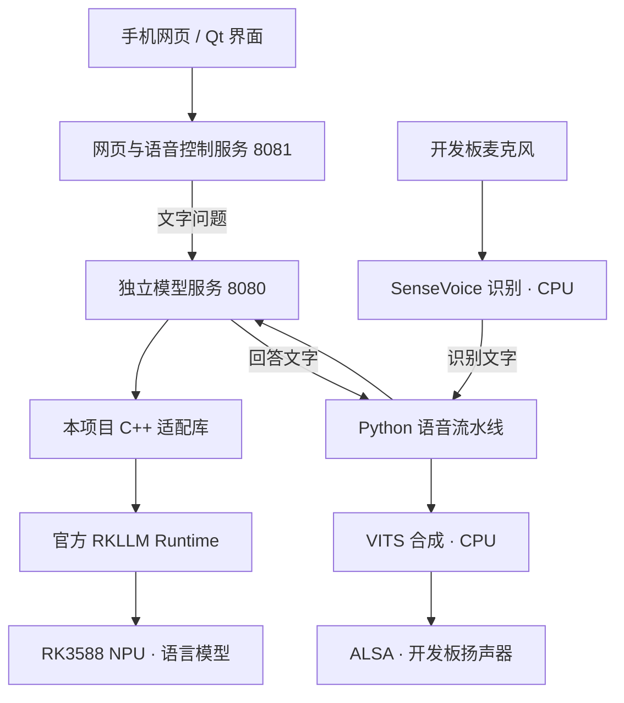

# RK3588 离线 AI 助手

[](https://github.com/zjinw520/rk3588-offline-assistant/actions/workflows/test.yml)
[](LICENSE)

面向 RK3588 的本地文字与语音助手工程。独立模型服务直接调用 **Rockchip RKLLM Runtime**，使用 NPU 运行已经转换好的语言模型，无需 RKLLama Python 框架。

**v0.1.0 是面向开发者的实验版本。** 模型服务已在正点原子 ATK-DLRK3588 8GB 上实测；同时公开在用的语音、网页、Qt 界面和原厂桌面桥接源码。完整应用尚未提供空白系统一键安装，其他板卡需要适配。

## 从哪里开始

| 你的情况 | 入口 |
| --- | --- |
| 第一次使用，先在板上跑文字问答 | **[独立模型服务入门](docs/QUICKSTART.md)**，不需要安装 RKLLama |
| 已有本工程早期的 RKLLama 部署，想迁移后端 | [检查](docs/BOARD_FIRST_CHECK.md) → [隔离推理](docs/BOARD_NPU_TRIAL.md) → [安装与回退](docs/BOARD_INSTALL.md) |
| 想复现语音、屏幕、原厂应用图标 | [应用布局与适配边界](docs/APPLICATION_LAYOUT.md)、[组件源码](components/README.md) |
| 准备外部文件 / 排查问题 | [模型与运行库](docs/MODELS.md)、[常见问题](docs/FAQ.md) |

现成 [Linux AArch64 入门包](https://github.com/zjinw520/rk3588-offline-assistant/raw/refs/heads/main/packages/rk3588-offline-assistant-v0.1.0-aarch64.tar.gz) 含本项目编译的适配库；[校验值](packages/SHA256SUMS) 和源码一同公开。包内**没有模型、第三方运行库或 Python 环境**。

## 能做什么

- 文字服务：模型列表、流式问答、取消、卸载；一次一个请求、一个模型，切换时释放前一个模型。
- 离线分词与聊天模板，按 token 预算裁剪历史；无需 PyTorch、TensorFlow 或 RKNN Toolkit Lite。
- 语音组件：SenseVoice 识别、VAD、唤醒词“你好小助手”、VITS 分段播报、连续 PCM 播放。
- 应用组件：Qt 触屏界面、网页文字问答、模型切换、音色/语速、系统音量同步、原厂桌面唤醒交接。
- 依赖检查、迁移回退、源码校验、测试与交叉编译脚本。

语言模型、语音模型、Qt、sherpa-onnx、ALSA 和 Rockchip Runtime 均为外部依赖。独立编写服务不改变模型本身的能力；小模型仍会答错，DeepSeek-R1 的长思考会增加等待时间。

## 运行结构



文字入门只需模型服务，默认 `127.0.0.1:18080`。现有完整部署使用本机 `8080` 模型接口、`8081` 网页/语音控制，以及原生窗口启动时的本机 `8082` 设置/音量接口。

所有文件准备齐全后，推理不需要互联网。板上界面可访问本机服务；手机网页仍需与板子保持局域网连接。`127.0.0.1` 表示当前设备，手机不能用它代指开发板。

## 已验证的参考环境

| 项目 | 实机版本或结果 |
| --- | --- |
| 开发板 | 正点原子 ATK-DLRK3588，8GB RAM |
| 系统 | Buildroot，Linux 5.10.209，AArch64，glibc 2.37 |
| NPU / 推理库 | RKNPU 0.9.8 / 官方 Linux AArch64 RKLLM Runtime 1.3.0 固定文件 |
| Python / 分词 | Python 3.10.5，Transformers 4.57.6 |
| 模型 | Qwen2-0.5B-Instruct、DeepSeek-R1-Distill-Qwen-1.5B，RK3588 W8A8 `.rkllm` |
| 实机检查 | 两模型推理及切换、取消后继续问答、网页代理、生成音频 ASR→LLM→TTS→PCM 链路、回退、两次重启 |

这不表示所有镜像、驱动和模型均兼容。人声唤醒、触屏/实体键体验、主观音质和长时间稳定性仍需现场回归，见 [验证记录](docs/TEST_STATUS.md)。

## API 范围

| 方法与路径 | 用途 |
| --- | --- |
| `GET /healthz` | 服务状态、是否允许推理、是否成功完成过推理 |
| `GET /api/version` | 本服务版本 |
| `GET /api/tags`、`GET /api/status` | 模型列表 |
| `GET /api/ps` | 当前模型及任务状态 |
| `POST /api/chat` | `model`、`messages`、`stream`；文字问答 |
| `POST /api/cancel` | 按 `request_id` 取消当前请求 |
| `POST /api/unload` | 空闲时释放模型 |

仅兼容本项目使用的部分 Ollama 风格字段，**不是完整 Ollama 或 OpenAI API**。不含图片理解、工具调用、并行推理、账号认证、模型下载或转换。采样参数由配置文件决定。`enable_thinking=false` 不受支持，不能通过该字段关闭 R1 的思考。

服务仅绑定本机回环地址；默认只查询状态，加 `--enable-inference` 才能生成回答。不要把无认证的应用控制接口暴露到公网。加载前检查其他进程是否使用 RKLLM；仍应停止冲突服务。底层模型初始化或驱动异常不保证能立即取消。

## 开发与构建

Python 3.10+。标准库测试不需要下载模型或连接开发板：

```sh
python -m unittest discover -s tests -v
# Zig 0.13.x，生成 AArch64 / glibc 2.17 适配库
python tools/build_native.py --zig /path/to/zig
# 或使用板卡 SDK；需检查目标 glibc 依赖
python tools/build_native.py --cxx /path/to/aarch64-linux-gnu-g++
python tools/build_release.py
```

CI 的模拟运行库和 HTTP 测试不进行 NPU 计算。完整 Qt 应用使用匹配板卡的 Qt 5.15 SDK 构建。欢迎按 [贡献指南](CONTRIBUTING.md) 提交可复现问题和适配记录。

## 许可证

本项目维护的独立代码采用 [MIT](LICENSE)。官方 SDK 头文件与许可证原文保留在 `third_party/rockchip-1.3.0/`；模型、运行库及其他依赖保持各自许可，见 [第三方来源](THIRD_PARTY.md)。发布内容不含密码、录音、聊天日志、虚拟环境、第三方模型权重或原厂 SystemUI 二进制。
